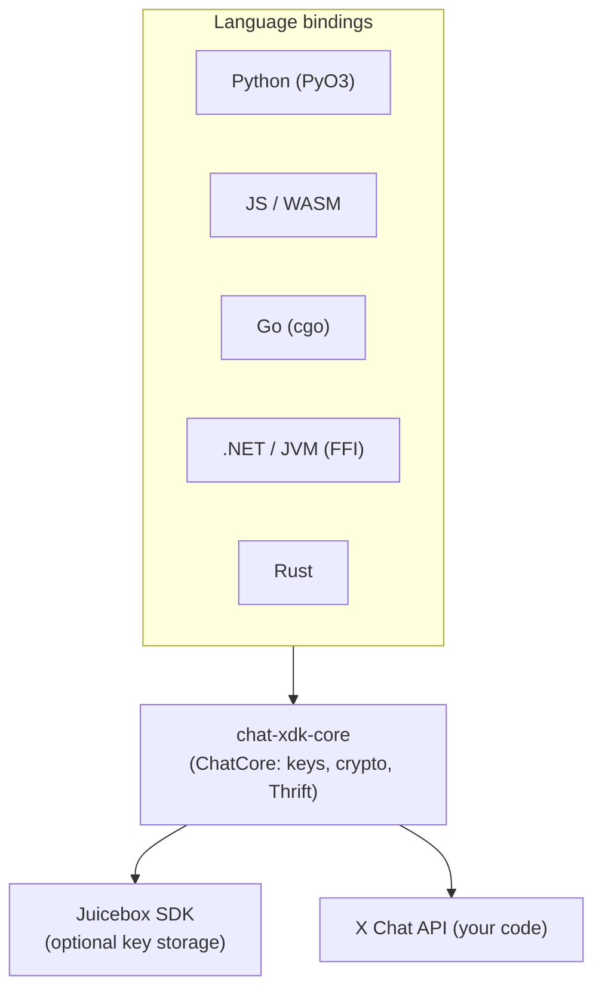

# chat-xdk

Encryption SDK for **X Chat** (encrypted Direct Messages). A single Rust core
(`chat-xdk-core`) handles key management, message encryption, signing, and the
Thrift wire protocol, exposed through idiomatic bindings for six languages.

## Bindings

| Language | Import | Backed by | Guide |
|----------|--------|-----------|-------|
| Rust | `chat-xdk-core` | — | [docs/API.md](docs/API.md) |
| Python | `chat_xdk` | PyO3 | [crates/pyo3/README.md](crates/pyo3/README.md) |
| JavaScript / WASM | `@xdevplatform/chat-xdk` | wasm-bindgen | [crates/wasm/js/README.md](crates/wasm/js/README.md) |
| JavaScript / WASM, servers that keep their keys | `@xdevplatform/chat-xdk-server` | wasm-bindgen | [crates/wasm/js-server/README.md](crates/wasm/js-server/README.md) |
| Go | `github.com/xdevplatform/chat-xdk/go/chatxdk` | cgo | [go/chatxdk/README.md](go/chatxdk/README.md) |
| .NET | `ChatXdk` | P/Invoke | [crates/dotnet/README.md](crates/dotnet/README.md) |
| JVM | `com.x.chatxdk` | JNA | [crates/jvm/README.md](crates/jvm/README.md) |

## Examples

The fastest way in: [`examples/`](examples) has **one small, clone-and-run
encrypted chat bot per binding**. Each imports the real binding, talks to the
X Chat API, and shows the full flow (key load → decrypt → reply → encrypt →
send). Start there:

```bash
cd examples && make test-all      # offline crypto tests for every binding (no creds)
```

See [`examples/README.md`](examples/README.md) for setup, getting an access
token, and running a bot live.

## The core flow

Every binding follows the same shape (names are camelCase in JS, snake_case in
Python/Rust, PascalCase in .NET/Go):

1. **Load keys** — import a private-key blob, or recover from Juicebox (below).
2. **Set identity** — `setIdentity({ userId, signingKeyVersion })` once per
   instance, where `signingKeyVersion` is the `public_key_version` returned
   when your keys were registered; every signed action defaults its sender and
   signing-key version to these values. Optionally `setCacheKeys(true)` and
   `setSigningKeys(signingKeys)` so the decrypt/encrypt calls below need no
   per-call key plumbing; `addSigningKeys(signingKeys)` adds more users' keys
   later without replacing the set. Or set a `resolvePublicKeys` hook that
   fetches `GET /2/users/{id}/public_keys`: the SDK then fetches the public
   keys a call lacks itself, and the key cache is on (see
   [Public keys and the hook](docs/API.md#public-keys-and-the-hook)).
3. **Initial load** — `decryptEvents({events})`: batch-decrypts a backlog,
   extracting conversation keys from `KeyChange` events and matching signing
   keys by user automatically. With a hook set, it fetches the public keys the
   batch lacks and decrypts once more (`decryptEventsAsync` in JS and .NET).
   Per-event errors are collected in the result;
   only invalid params throw. The events endpoint returns the `KeyChange` events in
   `meta.conversation_key_events`, separate from `data` — pass both together.
   The signing keys must include those of every member who made a key change
   (`GET /2/users/{id}/public_keys`), not only of the members whose messages
   you read: a key change that does not verify is reported in the result's
   `unverifiedKeyChanges`, with the member whose keys are missing, and a
   recent one has its key dropped, so the messages under it land in `errors`
   ([API.md](docs/API.md#signing-keys-for-key-changes)). For a batch of more
   than one conversation, read the keys and the version to encrypt with by
   conversation id: `conversationKeys.keysByConversation` and
   `conversationKeys.latestVersions`.
4. **Each new event** — `decryptEvent({eventB64, conversationKeys})`:
   decrypts one event (webhook / poll). Throws on failure. With the key
   cache on, `conversationKeys` can be left out, and a key change that
   verifies here is cached as one in a batch is.
5. **Reply** — `encryptMessage({conversationId, text})` or
   `encryptReply({conversationId, text, replyToEvent})` → POST the result to
   the X Chat API.
6. **Files** — a message with files is built first: start each upload, list
   its media hash key in the message's attachments, then
   `encryptFile({file, eventB64, mediaHashKey})` with the payload's
   `eventB64` (plus `conversationKey` and `conversationKeyVersion` unless the
   key cache holds them, as for the message). `decryptFile` opens a received
   file from its message's event, with the conversation's key map or, when
   that is left out, the key cache. A file no message carries, such as a
   group's avatar image under the conversation key, goes through
   `encryptFileWithKey({file, key})` and `decryptFileWithKey({encrypted, key})`.

| Method | Use case |
|--------|----------|
| `decryptEvents` | Batch (initial load, pagination). Self-extracts keys; collects errors. |
| `decryptEvent` | Single event (webhook, real-time) with cached keys. Throws on error. |

**Many users, many conversations.** A server keeps one chat per signed-in
user, for all of that user's conversations, never one per conversation, and
gives every chat the same `resolvePublicKeys` function over one cache of
public keys for the process. See [Many users, many
conversations](docs/API.md#many-users-many-conversations); each example has
the pattern as code that runs.

> The conversation id is part of the message signature. The SDK signs it in its
> canonical (colon-separated) form, so you can pass either the colon or the
> hyphen form used in REST URL paths. Every derived value (sender, signing-key
> version, conversation key) still takes an explicit per-call override.

### Quick start (Python)

```python
from chat_xdk import (
    Chat,
    DecryptEventParams,
    DecryptEventsParams,
    EncryptMessageParams,
    ImportKeysParams,
    SetIdentityParams,
)

chat = Chat()
chat.import_keys(ImportKeysParams(private_key_blob, signing_key_version=key_version))  # or Chat(config).unlock(pin)
chat.set_identity(SetIdentityParams(my_user_id, key_version))
chat.set_cache_keys(True)
chat.set_signing_keys(signing_keys)

result = chat.decrypt_events(DecryptEventsParams(raw_events))
for dm in result["events"]:
    if dm["event"]["type"] == "Message":
        print(dm["event"]["sender_id"], dm["event"]["content"]["text"])

event = chat.decrypt_event(DecryptEventParams(new_event_b64, {}))
payload = chat.encrypt_message(EncryptMessageParams(conversation_id, "hello"))  # POST to the X API
```

### Quick start (JavaScript / WASM)

```typescript
import { createChat } from "@xdevplatform/chat-xdk";

const chat = await createChat({ juiceboxConfig, getAuthToken });
await chat.unlock("2580");
chat.setIdentity({ userId: myUserId, signingKeyVersion });
chat.setCacheKeys(true);
chat.setSigningKeys(signingKeys);

const result = chat.decryptEvents({ events: rawEvents });
for (const dm of result.events) {
  if (dm.event.type === "message") console.log(dm.event.senderId, dm.event.content.text);
}
const event = chat.decryptEvent({ eventB64: newEventB64 });
const payload = chat.encryptMessage({ conversationId, text: "hello" });
```

Full per-language API (params + return types) is in [docs/API.md](docs/API.md);
runnable code for all six is in [`examples/`](examples).

## Key storage

Private keys can be held two ways:

- **Local blob** — `exportKeys()` / `importKeys()` move raw private-key bytes
  yourself, in every binding. Simplest; the bytes are **unencrypted identity
  material** — never commit them or log them, and zero them once stored. In
  JS only `@xdevplatform/chat-xdk-server`, for Node servers, has them; the
  chat `@xdevplatform/chat-xdk` creates, the one browsers load, keeps its
  keys in Juicebox and has no method that returns them.
- **Juicebox (production)** — `generate_keypairs()` creates the keys, then
  `setup(pin)` stores the generated keys in
  [Juicebox](https://juicebox.xyz/) distributed PIN-protected storage;
  `unlock(pin)` recovers them on any device, so nothing secret touches disk. The
  Juicebox config comes from the X API public-keys response. See the optional
  path in [`examples/python`](examples/python).

Registering your **public** key with the X API is a separate, one-time
provisioning step in both modes.

## Network access

The SDK makes one kind of request itself: an anonymous
`GET https://api.x.com/2/chat/features`, which reads the X API's feature
switches. They pick the format the SDK sends in. Each chat reads them when
it is created, again once `set_identity` gives it a sender, and again 5
minutes after each answer, so a change reaches a running chat without a
restart. The sender's request carries its bucket, the last four digits of
the user id (`?bucket=1234`), so every chat of one sender gets the same
answer; before that, the X API buckets the request by its address. Chats
that read the same URL share one request, and the answer stays for 5 minutes
after it arrives, so a chat created in that time takes it at once: an app
that creates a chat for each send makes one request per URL every 5 minutes.

The request carries no credentials and never delays or fails an SDK call.
One that fails is retried in the background, 1 second later, then after
twice the previous wait, at most 5 minutes apart. Each answer replaces the
one before; until an answer for the chat's URL arrives, every switch stays
off and sends stay in v0, the format 0.5.x sends. Each binding's HTTP stack
picks the proxy, if any, and a process that reaches the X API under another
host name sets `CHAT_XDK_API_BASE_URL` to its base URL, in place of
`https://api.x.com` (see
[ARCHITECTURE.md](docs/ARCHITECTURE.md#feature-switches)). The Rust crate and the C
ABI never make the request: a Rust app or a C caller requests the URL
`feature_switches_url` (`chat_xdk_feature_switches_url`) returns, again every
5 minutes, and hands the chat each answer (`set_feature_switches`,
`chat_xdk_set_feature_switches`); a chat that gets none sends v0.

## Cryptography

| Purpose | Algorithm |
|---------|-----------|
| Conversation key exchange | ECIES — ECDH P-256 + AES-128-GCM |
| Message content | XSalsa20-Poly1305 (256-bit key, random 192-bit nonce) |
| Media files | `crypto_secretstream_xchacha20poly1305` |
| Message authorship | ECDSA P-256 over the encrypted content |
| Key derivation | HKDF-SHA256 |

Private key types are zeroized on drop (`zeroize`) and redact to `[REDACTED]` in
debug output; all randomness comes from the OS CSPRNG. Details and the full
encrypt/decrypt walkthroughs are in [docs/CRYPTO.md](docs/CRYPTO.md).

## Architecture



`ChatCore` is the platform-agnostic engine; `Chat` adds the Juicebox lifecycle.
Bindings are thin FFI wrappers — the crypto lives in one place. Module structure
and data flows: [docs/ARCHITECTURE.md](docs/ARCHITECTURE.md).

## Project structure

```
chat-xdk/
├── crates/
│   ├── core/     # chat-xdk-core: ChatCore engine, crypto, keys, Thrift types
│   ├── pyo3/     # Python binding (chat_xdk)
│   ├── wasm/     # JS/WASM binding (+ js/ wrapper and tests, js-server/ server package)
│   ├── ffi/      # C ABI (chat_xdk.h): Go's static archive, .NET's and the JVM's shared library
│   ├── dotnet/   # .NET binding (P/Invoke)
│   └── jvm/      # JVM binding (JNA)
├── go/chatxdk/   # Go binding (cgo + prebuilt static archives)
├── examples/     # one clone-and-run bot per binding (+ Makefile, CI)
├── docs/         # API.md, ARCHITECTURE.md, CRYPTO.md
└── tests/        # cross-binding fixtures (sdk_vectors.json)
```

## Building

```bash
make build              # Rust workspace
make test               # Rust tests

make wheel-dev          # Python: maturin develop
make wasm               # WASM: wasm-pack build --target web, staged into both npm packages
make test-go            # Go: build staticlib + go test
make dotnet-test        # .NET: native cdylib + xUnit
make jvm-test           # JVM: native cdylib + mvn test (JDK 17+)
```

The repo depends on the [Juicebox SDK](https://github.com/juicebox-systems/juicebox-sdk)
via a path dependency at `../juicebox-sdk` (CI checks it out automatically). For
JS/WASM with Juicebox key storage you also build juicebox-sdk's wasm crate — see
[crates/wasm/js/README.md](crates/wasm/js/README.md).

## Releasing

Maintainers release from GitHub: Actions → **Release** → Run workflow
([`release.yml`](.github/workflows/release.yml)). Every binding has the same
version, so one run bumps it, tags `vX.Y.Z` and publishes to each registry.

| Input | Meaning |
|---|---|
| `binding` | What to publish: `all`, or one of `rust`, `python`, `js`, `go`, `dotnet`, `java`. `js` publishes both npm packages. `js-server` republishes only `@xdevplatform/chat-xdk-server`, from the tag of a version already released: it needs `bump: none`, and commits and tags nothing. |
| `bump` | `patch`, `minor`, `major` or `beta`. `none` releases the version already in the manifests, or republishes it if its tag exists. |
| `dry_run` | On by default: builds and checks everything, publishes and pushes nothing. |

npm publishes by trusted publishing, which npmjs.com registers per package:
`@xdevplatform/chat-xdk` and `@xdevplatform/chat-xdk-server` each need a
Trusted Publisher for GitHub Actions with organization `xdevplatform`,
repository `chat-xdk`, workflow `release.yml` and no environment. Before it
tags anything, a run that publishes to npm checks that npm accepts it as the
publisher of each package, dry runs included.

A version already on npm is skipped. So when a release publishes
`@xdevplatform/chat-xdk` and `@xdevplatform/chat-xdk-server` fails, fix the
cause, then run the workflow with `binding: js-server`, `bump: none` and
`dry_run` off.

## Documentation

- **[docs/API.md](docs/API.md)** — full API reference for every binding
- **[docs/ARCHITECTURE.md](docs/ARCHITECTURE.md)** — modules and data flows
- **[docs/CRYPTO.md](docs/CRYPTO.md)** — algorithms, key lifecycle, wire formats

## License

MIT — see [`LICENSE`](LICENSE).

Third-party open-source components and their notices are listed in
[`THIRD_PARTY_NOTICES.md`](THIRD_PARTY_NOTICES.md).
