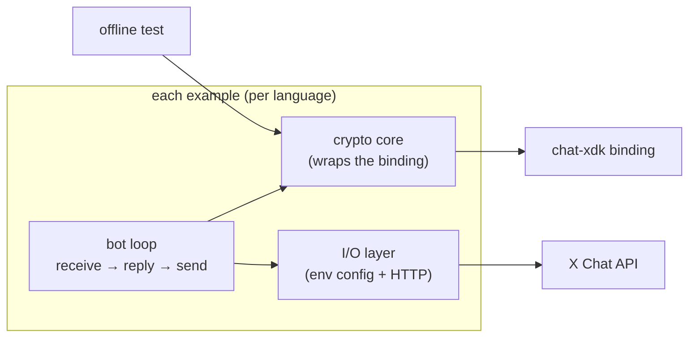

# chat-xdk examples

One small, self-contained **encrypted chat bot** per chat-xdk language binding.
Each example imports the *real* binding for its language, talks to the X Chat
API over HTTP, and showcases the messaging core:

- **Key management** — import existing private keys (or generate + register new ones)
- **Conversation keys** — prepare/decrypt the symmetric key shared by participants
- **Encryption** — turn a reply into an encrypted, signed message for the X API
- **Decryption** — every page of events through the batch path
  (`decryptEvents`), which fetches the public keys it lacks through a hook;
  each crypto core also wraps the single-event path (`decryptEvent`)

Every example is a small bot: it reads incoming DMs, decrypts them, generates a
reply (a simple echo), encrypts the reply, and sends it back.

The bots deliberately stop at that messaging core. The rest of the SDK surface
— group management (`prepareGroupCreate` / `prepareGroupMembersChange` /
`prepareGroupMembersRemove`),
reactions (`encryptAddReaction` / `encryptRemoveReaction`), muting and
unmuting a conversation (`prepareConversationMute`), media files
(`encryptFile` / `fileEncryptor` / `decryptFile` / `fileDecryptor`), and files
under a key such as group avatars (`encryptFileWithKey` / `decryptFileWithKey`)
— is documented in
[`../docs/API.md`](../docs/API.md), with tested reference call shapes in each
binding's test suite (`crates/*/tests`, `crates/wasm/js/tests`,
`go/chatxdk/chatxdk_test.go`).

## Juicebox (optional)

The bots load keys from a local private-key blob so they stay clonable. In
production, X Chat clients keep keys in Juicebox PIN-protected storage instead;
every native binding exposes `setup`/`unlock` for it. The **Python bot** is the
reference implementation of that path: set `CHAT_PIN` in its `.env` and it
fetches the Juicebox config from the X API and unlocks (or registers) the keys
via PIN — see [`python/run.py`](python/run.py) and
[`python/chat_core.py`](python/chat_core.py). The other five bots use only the
local-blob path; port the Python flow if you need PIN storage elsewhere.

| Language | Directory | Binding it imports | Toolchain |
|----------|-----------|--------------------|-----------|
| Python | [`python/`](python) | `chat_xdk` (PyO3) | Python 3.10+ |
| JavaScript / WASM | [`js/`](js) | `@xdevplatform/chat-xdk-server` (WASM) | Node 18+ |
| Rust | [`rust/`](rust) | `chat-xdk-core` crate | Rust stable |
| Go | [`go/`](go) | `github.com/xdevplatform/chat-xdk/go/chatxdk` (cgo) | Go 1.21+ |
| .NET | [`dotnet/`](dotnet) | `ChatXdk` (P/Invoke) | .NET 8+ |
| JVM | [`jvm/`](jvm) | `com.x.chatxdk` (JNA) | JDK 17+, Maven |

## How they are structured

Each example separates two layers so the crypto is easy to read and test:

1. **A crypto core** — a thin wrapper around the chat-xdk binding that does
   key unlock/import, conversation-key handling, message encryption, and the
   two decryption paths. This layer makes no network calls of its own, so it
   can be unit-tested directly. The one thing it needs from the network,
   other users' public keys, comes through a fetch function the I/O layer
   hands it.
2. **A thin I/O layer** — config from environment variables, local/in-memory
   conversation state, and X Chat API calls over plain HTTP.



The offline test exercises the crypto core directly; only the I/O layer touches
the network.

### Signing keys for key changes

A bot verifies each event with the signing keys of the user who sent it, which
come from the X API (`GET /2/users/{id}/public_keys`). A key change is signed
by the member who made it, who may have sent none of the messages on the page.
Without that member's keys a recent key change does not verify, its key is
dropped, and the messages under it do not decrypt.

The SDK fetches those keys itself, through a hook. Each example's crypto core
sets the hook once, in `fetchPublicKeysWith` (`fetch_public_keys_with`,
`FetchPublicKeysWith`). The hook is given user ids. It fetches each user's
public keys with the example's X API client and returns the records as the API
sent them, by user id. A user whose fetch fails is logged and left out, so one
user's failure does not fail the page.

Each bot sends every page of events, key changes and messages together,
through the batch decrypt. When the page names signing keys the SDK does not
hold, the SDK calls the hook for those users, stores what it returns, and
decrypts the page once more. The bot replies to the messages in the result,
and logs what the result still reports: `missingSigningKeys`,
`unverifiedKeyChanges`, `undecryptableKeyChanges` and `rejectedSigningKeys`.

| Language | Set the hook | Batch decrypt that calls it |
|----------|--------------|-----------------------------|
| JavaScript | `createChat({ resolvePublicKeys })` or `chat.setResolvePublicKeys(hook)` | `await chat.decryptEventsAsync(...)` |
| .NET | `chat.ResolvePublicKeys = hook` | `await chat.DecryptEventsAsync(...)` |
| Python | `chat.set_resolve_public_keys(hook)` | `chat.decrypt_events(...)` |
| Go | `chat.SetResolvePublicKeys(hook)` | `chat.DecryptEvents(...)` |
| JVM | `chat.setResolvePublicKeys(resolver)` | `chat.decryptEvents(...)` |
| Rust | `chat.set_resolve_public_keys(Some(hook))` | `chat.decrypt_events(...)` |

In JavaScript and .NET the hook returns a promise or a task, so only the
`Async` methods call it. In the other four languages the hook blocks, and the
usual methods call it.

The hook also serves the calls that make a conversation key:
`prepareConversationKeyChange`, `prepareGroupCreate`,
`prepareGroupMembersChange` and `prepareGroupMembersRemove` (their `Async`
forms in JavaScript and .NET). A call that passes no public keys encrypts the
key to the public keys the SDK holds for its members, and fetches the ones it
lacks.

The browser app in [`js/public/`](js/public) drives the lower-level WASM
`Chat`, which has no hook. It does the same steps by hand: `missingPublicKeys`
names the users to fetch, and `addPublicKeys` stores their records.

### Many signed-in users in one process

Each bot serves one signed-in user. A server that signs many users in follows
two rules, and every example has them as code with an offline test:

- **One chat per signed-in user.** A chat holds one user's private keys and
  signs as that user. Keep one per signed-in user, for all of that user's
  conversations, and never one per conversation: the chat keeps conversation
  keys by conversation and public keys by user id. `UserChats` does this: it
  returns the user's chat, and creates it on the first call.
- **One public-keys hook for every chat.** Other users' public keys are the
  same whichever chat asks. `SharedPublicKeys` is one hook function over one
  cache of `GET /2/users/{id}/public_keys` answers for the whole process, so
  two chats that meet the same user cost one request. It shares a lookup
  that is under way, drops a lookup that failed so the next call tries
  again, and fetches an answer again after its TTL (5 minutes unless you say
  otherwise), so a key a user registers later is picked up.

| Language | File | Shared hook | One chat per user |
|----------|------|-------------|-------------------|
| JavaScript | [`js/src/multi-user.mjs`](js/src/multi-user.mjs) | `sharedPublicKeys(getPublicKeys, { ttlMs })` | `UserChats.chatFor(user)` |
| Python | [`python/multi_user.py`](python/multi_user.py) | `SharedPublicKeys(fetch, ttl_seconds).resolve` | `UserChats.chat_for(...)` |
| Go | [`go/multiuser.go`](go/multiuser.go) | `NewSharedPublicKeys(fetch, ttl).Resolve` | `UserChats.ChatFor(...)` |
| Rust | [`rust/src/multi_user.rs`](rust/src/multi_user.rs) | `SharedPublicKeys::new(fetch)`, and its `hook()` | `UserChats::chat_for(...)` |
| .NET | [`dotnet/ChatBot/MultiUser.cs`](dotnet/ChatBot/MultiUser.cs) | `new SharedPublicKeys(fetch, ttl).ResolveAsync` | `UserChats.ChatFor(...)` |
| JVM | [`SharedPublicKeys.java`](jvm/src/main/java/com/example/chatbot/SharedPublicKeys.java), [`UserChats.java`](jvm/src/main/java/com/example/chatbot/UserChats.java) | `new SharedPublicKeys(fetcher)` | `UserChats.chatFor(...)` |

Each example's multi-user test signs two users in and checks that their
chats fetch the keys of a user they both meet once, that one chat serves two
conversations, and that the shared hook retries a failed lookup and fetches
again after its TTL. The JavaScript example also runs one bot per signed-in
user this way: [`js/src/multi-bot.mjs`](js/src/multi-bot.mjs).

With a hook set, give a chat keys you already hold with `addSigningKeys` or
`addPublicKeys`. `setSigningKeys` replaces every stored key, the fetched
ones included. [Many users, many
conversations](../docs/API.md#many-users-many-conversations) has the rest:
what a chat keeps, and when a key a user registers later is picked up.

## Running an example

```bash
cd examples/<language>
cp .env.example .env   # set X_ACCESS_TOKEN + CHAT_CONVERSATION_ID
# follow the per-language README to build and run
```

## Getting an access token

`X_ACCESS_TOKEN` must be an **OAuth2 user-context access token** for your bot
account, with the `dm.read` and `dm.write` scopes. The easiest way to mint one
is [`xurl`](https://github.com/xdevplatform/xurl), the X API CLI (its OAuth2
flow already requests the DM scopes):

```bash
# 1. Install (macOS)
brew install --cask xdevplatform/tap/xurl

# 2. Register your app's credentials (from the X Developer Portal)
xurl auth apps add my-bot --client-id YOUR_CLIENT_ID --client-secret YOUR_CLIENT_SECRET

# 3. Run the OAuth2 user-context flow (opens a browser, asks for DM scopes)
xurl auth oauth2 --app my-bot

# 4. Verify it works
xurl /2/users/me
```

`xurl` stores the token in `~/.xurl`; copy the `access_token` value into your
`.env` as `X_ACCESS_TOKEN`. Set `CHAT_CONVERSATION_ID` to the conversation the
bot should watch (the other user's ID for a 1:1, or a `g…` group ID).

## Testing

Each example ships **two** test paths:

- **Offline test (committed, runs in CI, no credentials):** drives the binding
  through a real `encrypt → decrypt` round-trip plus the deterministic
  key/signature vectors in
  [`../tests/fixtures/sdk_vectors.json`](../tests/fixtures/sdk_vectors.json),
  with **no mocking of the SDK**. Run `make test-all` (see [`Makefile`](Makefile)).
- **Live e2e (opt-in):** a gated test/harness that runs the messaging surface
  against the real X Chat API. It is skipped unless `CHATXDK_E2E=1` and the
  credential env vars are set, so it never runs in CI. Every language's script
  runs the same flow:
  1. batch-decrypt inbound history (paginating when a second page exists)
  2. rotate the conversation key (`prepareConversationKeyChange` →
     `POST …/keys`), then decrypt + verify its own KeyChange event back
  3. send a threaded reply with a mention entity and a 24h TTL under the
     rotated key, fetch it back, decrypt it via the single-event path, and
     assert it verifies — closing the sign → verify loop end to end
  4. add a reaction to the sent message, decrypt + verify it, then remove it

  Three optional extras: `CHATXDK_E2E_MEDIA=1` additionally starts a media
  upload, builds a message whose attachment names the upload's
  `media_hash_key`, encrypts the file from that message's `event_b64`,
  finishes the upload (append → finalize), sends the message, then downloads
  and decrypts the file back to the original bytes; `CHATXDK_E2E_GROUPS=1`
  additionally creates a
  group (the two-signature create), sends a group message, adds the 1:1
  partner as a member (a key rotation), then removes that partner and rotates
  the key again for the members who stay (`group_key_rotation_data` plus both
  signatures on `POST …/members/remove`); `CHAT_PIN=…` (Python only)
  additionally unlocks keys via live Juicebox and checks they match the
  blob-loaded ones. Live sends carry a `chat-xdk e2e [<lang>] <timestamp>`
  marker and the TTL keeps the test conversation from accumulating history.

## Encrypted media

Media never travels in the message: the message carries a `media` attachment
descriptor naming a `media_hash_key`, and the bytes themselves are encrypted
and stored via the chat media endpoints. Each file is encrypted under a key
derived from its message and its attachment, so the message comes first:
start each upload to get its `media_hash_key`, build the message with
attachments naming those keys, then encrypt each file from the message's
`event_b64` (returned with the send payload) and finish its upload. To
decrypt, the SDK reads the message that carries the media and derives that
file's key, whichever client sent it.
Every example's crypto core shows the pattern with the SDK's
**incremental** file API (`fileEncryptor` / `fileDecryptor`), feeding
fixed-size chunks through `push` and sealing with `finish` — memory stays
bounded regardless of file size, which matters most in the WASM binding where
the heap cannot hold large files whole:

- **upload + encrypt + send**: `startMediaUpload`/`start_media_upload`
  (initialize with the encrypted size from
  `encryptedFileSize`/`encrypted_file_size`, returning the upload session and
  the `media_hash_key`) → `encryptReply`/`encrypt_reply` with an attachment
  descriptor naming that key → `encryptMedia`/`encrypt_media` with the
  payload's `event_b64`, the conversation key and version the message was
  encrypted under, and the `media_hash_key` (chunked `push` + `finish`) →
  `finishMediaUpload`/`finish_media_upload`
  (3 MB appends → finalize) → send the message
- **download + decrypt**: `downloadMedia`/`download_media` (raw **bytes** —
  never decode the body as text; that corrupts the ciphertext) →
  `decryptMedia`/`decrypt_media` with the raw event of the message that
  carries the media, the conversation key map and the `media_hash_key`
  (chunked `push`, then `finish`, which errors if the file was truncated)

## What these examples are not

To stay clonable and simple, the examples deliberately leave out the production
plumbing the internal X services use: no Kubernetes, no message-queue fan-out,
no internal storage service, no secret-management mounts, no service-to-service
mTLS. Key storage uses a local private-key blob (or a freshly generated +
registered key) instead of the PIN-recovery key-storage network. Swap those
pieces in as needed for a real deployment.

## License

MIT
